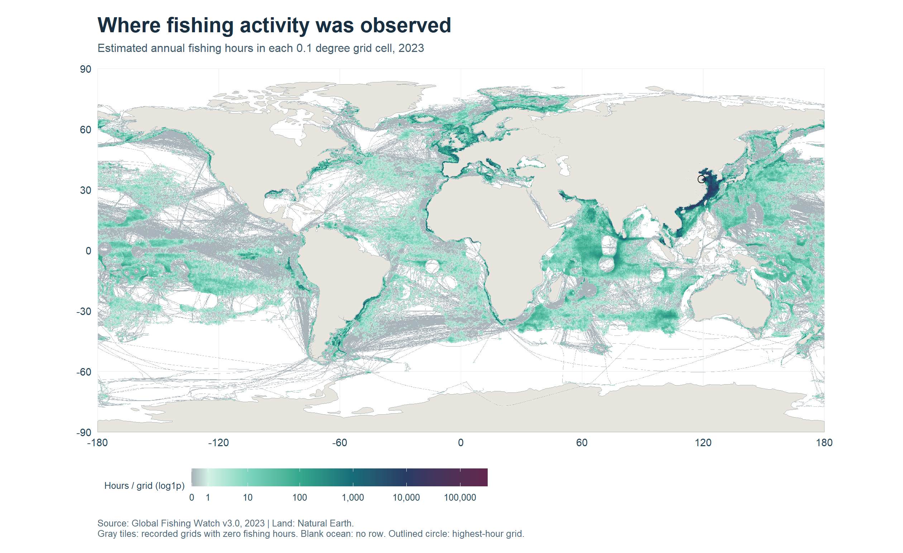
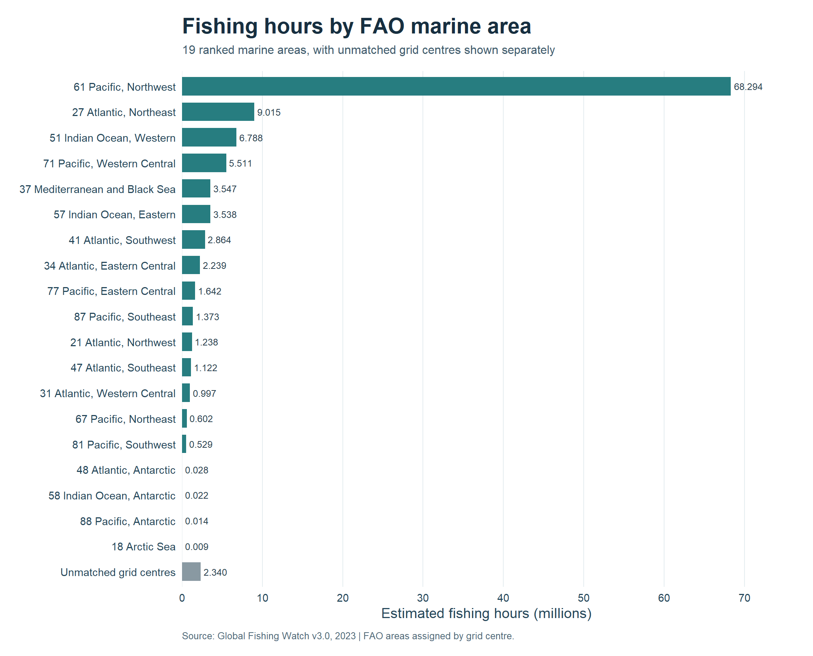
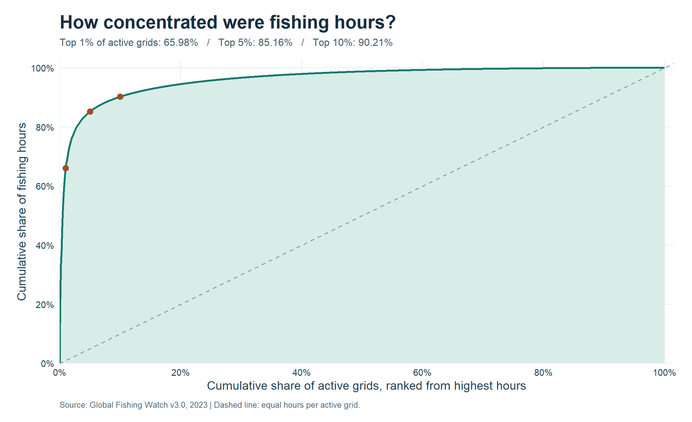
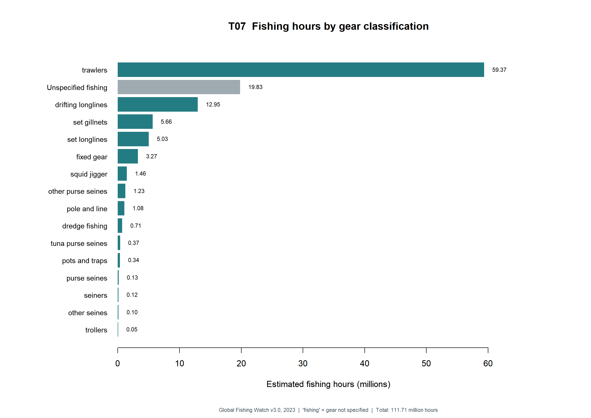
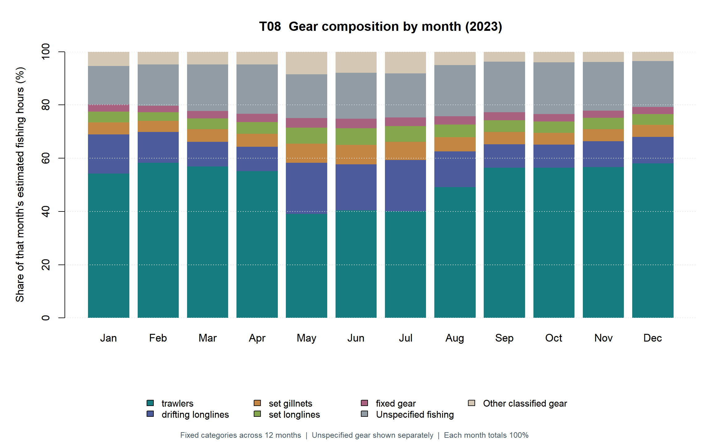
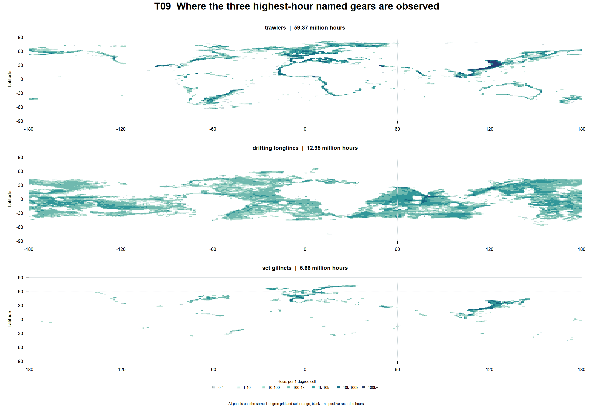

```{r setup, include=FALSE}
knitr::opts_chunk$set(echo = FALSE, warning = FALSE, message = FALSE)
```

Module A - Spatial distribution {data-icon="fa-globe"}
=====================================================

### T01 - Annual grid map

```{r}

```

### T02 - FAO marine area totals

```{r}

```

### T03 - Fishing-hour concentration

```{r}

```

Module B - Monthly variation {data-icon="fa-chart-line"}
========================================================

### T04 - Monthly totals

TODO(module-b): embed `../module_B/DS4073_B_T04_T06/results/figures/T04_monthly_total.png` once analysis_B.R produces it.

### T05 - Average daily hours

TODO(module-b): embed `../module_B/DS4073_B_T04_T06/results/figures/T05_daily_average.png` once analysis_B.R produces it.

### T06 - Peak month per FAO area

TODO(module-b): embed `../module_B/DS4073_B_T04_T06/results/figures/T06_area_peaks.png` once analysis_B.R produces it.

Module C - Gear classification {data-icon="fa-ship"}
=====================================================

### T07 - Annual gear ranking

```{r}

```

### T08 - Monthly gear mix

```{r}

```

### T09 - Gear maps

```{r}

```

Module D - Flag distribution {data-icon="fa-flag"}
===================================================

### T10 - Flag ranking

TODO(module-d): embed `../module_D/DS4073_D_T10_T12/results/figures/T10_flag_ranking.png` once analysis_D.R produces it.

### T11 - Flag activity by area

TODO(module-d): embed `../module_D/DS4073_D_T10_T12/results/figures/T11_flag_area.png` once analysis_D.R produces it.

### T12 - Top three known flags per area

TODO(module-d): embed `../module_D/DS4073_D_T10_T12/results/figures/T12_top3_flags_by_area.png` once analysis_D.R produces it.

Module E - Hotspot synthesis {data-icon="fa-fire"}
===================================================

### T13 - Hotspot map

TODO(module-e): embed `../module_E/DS4073_E_T13_T15/results/figures/T13_hotspot_map.png` once analysis_E.R produces it.

### T14 - Hotspot flag composition

TODO(module-e): embed `../module_E/DS4073_E_T13_T15/results/figures/T14_hotspot_flags.png` once analysis_E.R produces it.

### T15 - Hotspot gear composition

TODO(module-e): embed `../module_E/DS4073_E_T13_T15/results/figures/T15_hotspot_gears.png` once analysis_E.R produces it.