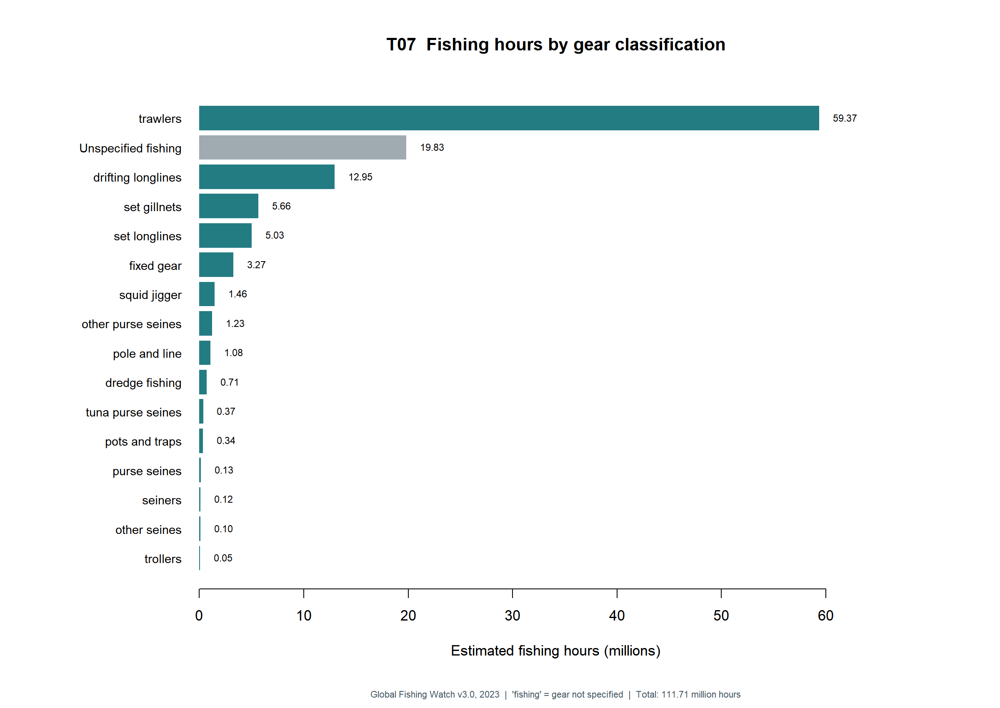
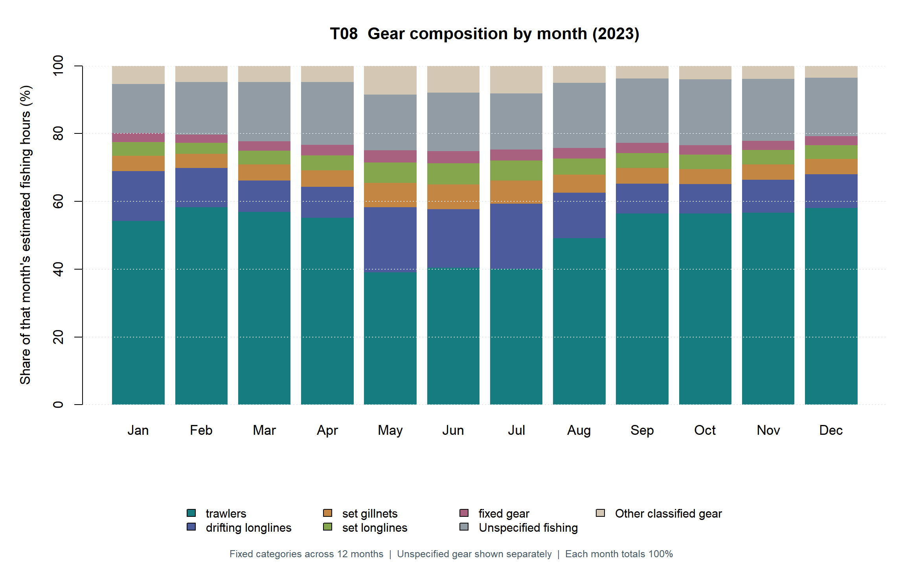
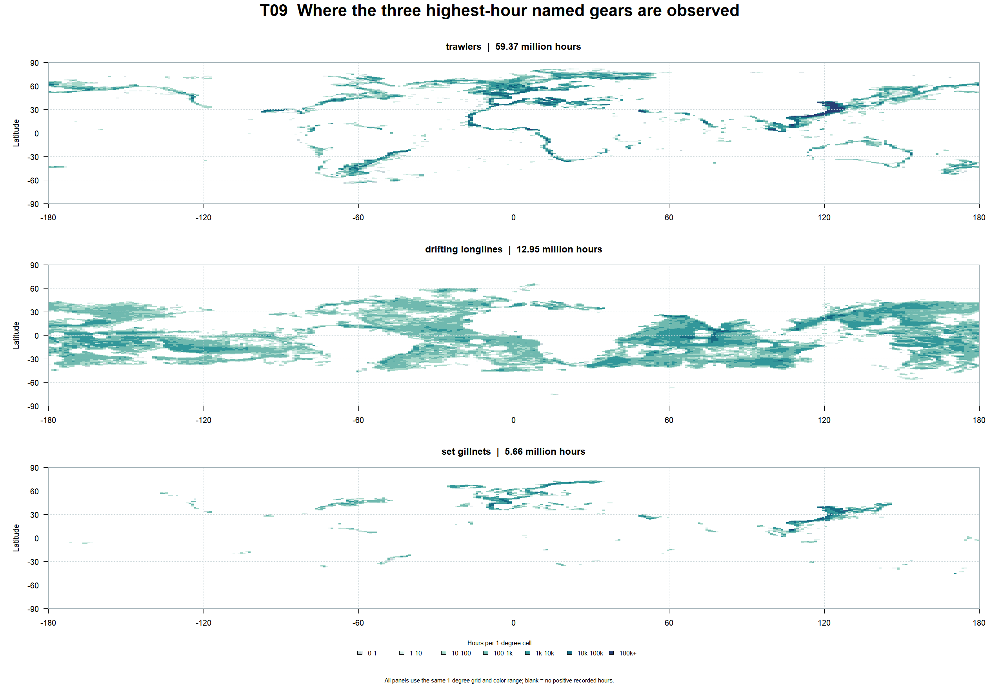

```{r setup, include=FALSE}
knitr::opts_chunk$set(echo=FALSE, warning=FALSE, message=FALSE, out.width="100%")
annual <- read.csv("results/tables/T07_annual_gear.csv")
monthly <- read.csv("results/tables/T08_monthly_gear_share.csv")
```

## T07 — Annual fishing hours by gear classification

```{r t07}

```

Trawlers contributed **59.37 million estimated hours (53.15%)**. The gray `fishing` category is an unspecified gear classification and contributed **17.75%**. Shares use all 2023 estimated fishing hours as denominator.

## T08 — Monthly gear composition

```{r t08}

```

Each bar divides the gear's hours by that month's total. Fixed categories sum to 100% in every month. Trawler share ranged from **39.12% in May** to **58.22% in February**.

## T09 — Spatial footprints of named gears

```{r t09}

```

The maps select the three highest-hour **named** gears in T07. They share one-degree cells and the same color thresholds. Each cell reports summed estimated hours, not effort per square kilometer. Blank cells have no positive recorded hours in the shared data.

## Method and sources

Generated with base R from `DS4073_GFW_2023_Shared`, Global Fishing Watch v3.0 monthly fleet data for 2023. See `analysis_C.R` for calculations and reconciliation checks. Apparent fishing activity is estimated from AIS and is neither catch nor a complete census. AIS and gear classification coverage vary by location.
