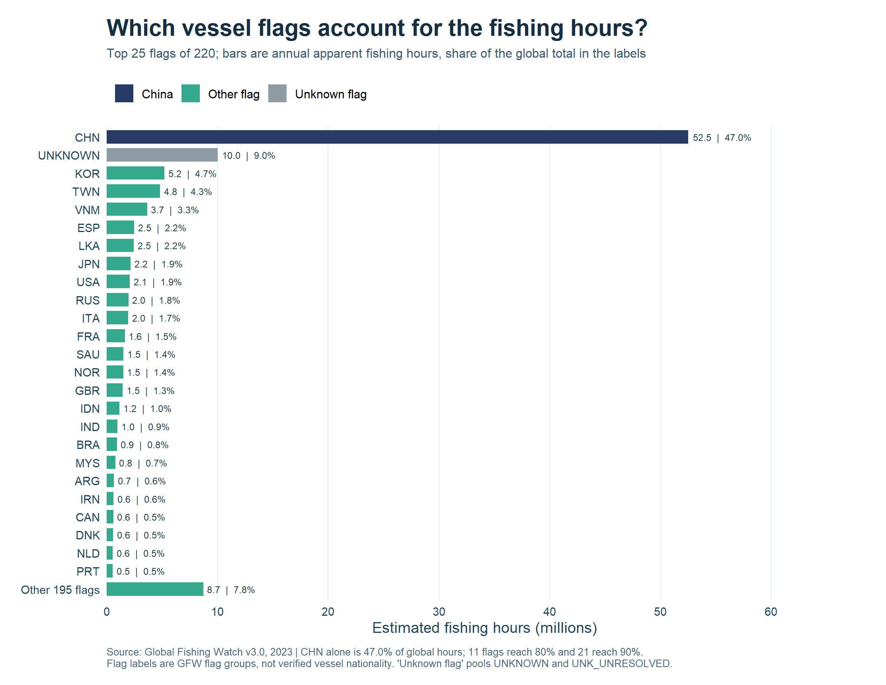
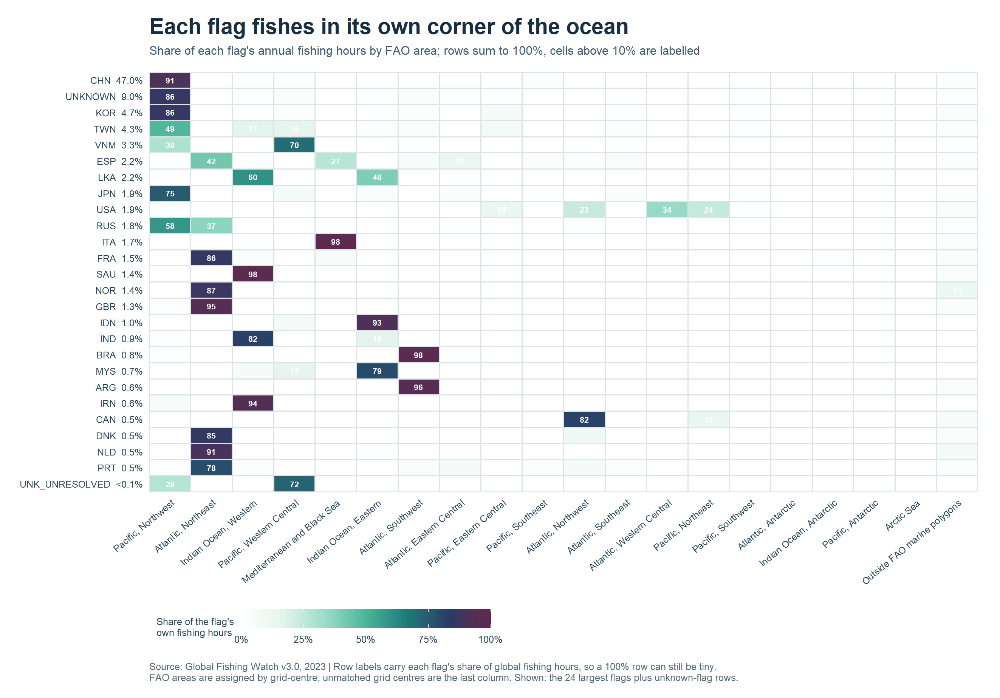
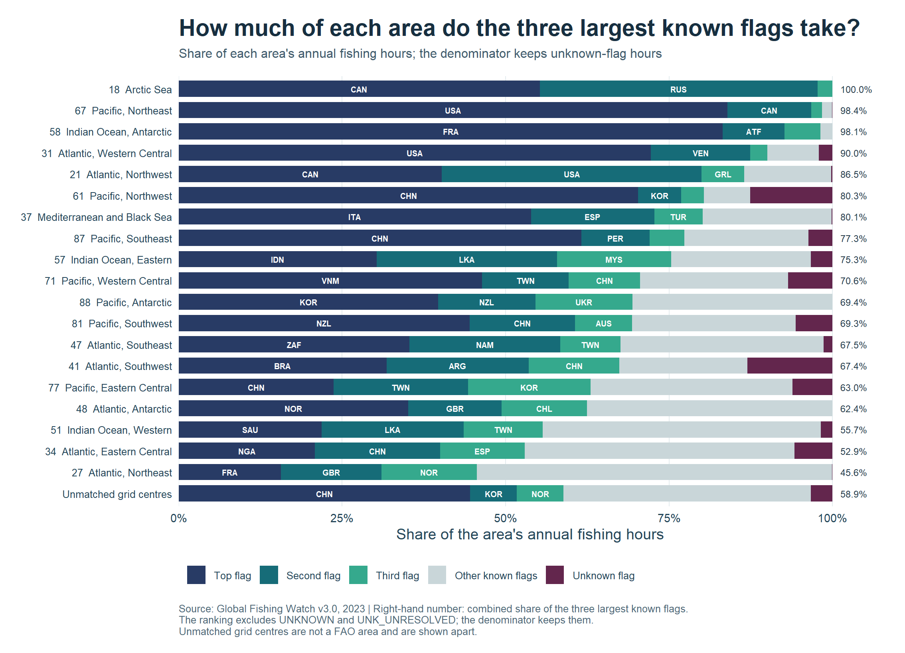

```{r setup, include=FALSE}
knitr::opts_chunk$set(echo = FALSE, warning = FALSE, message = FALSE, out.width = "100%")
source("analysis_D.R", local = TRUE)
result <- run_d(params$shared_dir)

flags <- result$flags
top3 <- result$top3
official_top3 <- top3[top3$official_area, ]
flag_area <- result$flag_area

total_millions <- formatC(result$total / 1e6, format = "f", digits = 2, big.mark = ",")
n_flags <- nrow(flags)
n80 <- which(flags$cumulative_share >= 0.8)[1]
n90 <- which(flags$cumulative_share >= 0.9)[1]
top1 <- flags[1, ]
unknown_share <- sum(flags$share_of_global[flags$is_unknown])
median_top3 <- median(official_top3$top3_share_of_area)
lowest_top3 <- official_top3[which.min(official_top3$top3_share_of_area), ]
highest_top3 <- official_top3[which.max(official_top3$top3_share_of_area), ]
min_known_flags <- min(official_top3$n_known_flags)
worst_unknown <- official_top3[which.max(official_top3$unknown_share), ]

top10 <- head(flags, 10L)
top10_table <- data.frame(
  Rank = top10$rank,
  `Flag group` = top10$flag_group,
  `Fishing hours` = hours_format(top10$fishing_hours),
  `Share of global` = percent_format(top10$share_of_global),
  `Cumulative share` = percent_format(top10$cumulative_share),
  check.names = FALSE
)
```

## T10 - Which vessel flags dominate? {#t10}

```{r t10}

```

```{r t10-table}
knitr::kable(top10_table, align = c("r", "l", "r", "r", "r"),
             caption = "Top ten flag groups by annual apparent fishing hours, 2023.")
```

`r top1$flag_group` accounts for `r percent_format(top1$share_of_global)` of all
`r total_millions` million estimated fishing hours, and the share is heavily top-heavy:
`r n80` of `r n_flags` flag groups reach 80% and `r n90` reach 90%. The unlabeled
`UNKNOWN` group is the second largest entry at `r percent_format(unknown_share)`,
larger than every named flag except China. Shares are computed over all recorded
hours, so the unknown group is never hidden inside a named flag.

## T11 - How is flag activity distributed by area? {#t11}

```{r t11}

```

Each cell divides a flag's hours in one FAO area by **that flag's own annual total**,
so every row sums to 100% and the chart answers "where does this flag fish". Reading it
column-wise would instead answer "who fishes in this area", which is T12. The rows are
the 24 largest flags plus the two unknown groups; the full
`r nrow(flag_area)`-row flag-by-area table with every one of the `r n_flags` flags is in
`results/tables/T11_flag_area.csv`.

The pattern is regional: most flags put nearly all their hours into one or two areas.
China concentrates `r percent_format(flag_area$share_of_flag[flag_area$flag_group == "CHN" & flag_area$area_code == "61"])`
in the Northwest Pacific, the United Kingdom
`r percent_format(flag_area$share_of_flag[flag_area$flag_group == "GBR" & flag_area$area_code == "27"])`
in the Northeast Atlantic and Indonesia
`r percent_format(flag_area$share_of_flag[flag_area$flag_group == "IDN" & flag_area$area_code == "57"])`
in the Eastern Indian Ocean. Only a few distant-water flags, such as Spain, the United
States and Taiwan, spread across four or more areas. The last column holds grid centres
that fall outside every FAO polygon: it takes
`r percent_format(sum(result$areas$fishing_hours[result$areas$area_code == "UNMATCHED"]) / result$total)`
of all fishing hours, which is small overall but concentrated in flags that work coasts
and enclosed seas.

## T12 - What share do the top three known flags contribute per area? {#t12}

```{r t12}

```

For each area the three largest **known** flags are ranked, and their combined hours are
divided by **all hours recorded in that area, including `UNKNOWN` and `UNK_UNRESOLVED`**.
That denominator matters: if unknown hours were dropped, a thinly labeled area could
report a top-three share near 100% without any flag actually dominating it.

Across the `r nrow(official_top3)` FAO areas the median top-three share is
`r percent_format(median_top3)`. The lowest is `r lowest_top3$area_name`
(`r percent_format(lowest_top3$top3_share_of_area)`), where no flag reaches even a fifth
of the area, and the highest are the polar and semi-enclosed areas where a handful of
national fleets operate: `r highest_top3$area_name` reaches
`r percent_format(highest_top3$top3_share_of_area)`. That value is 100% only because
`r highest_top3$n_known_flags` known flags are recorded there at all, so "top three"
means "all three". The smallest number of known flags in any area is
`r min_known_flags`, so no area has fewer than three to rank.

Unknown flag hours are uneven. They are `r percent_format(worst_unknown$unknown_share)` of
`r worst_unknown$area_name` but close to zero in the Northeast Atlantic and the
Mediterranean, where fleets are well covered by AIS and well identified. Unmatched grid
centres are shown as a separate bar because they are not a FAO area.

## Method and sources

All three tasks read only the annual summary tables of `DS4073_GFW_2023_Shared`
(`annual_flag.csv`, `annual_flag_area.csv`, `area_names.csv`); no detail grid file is
needed, so the page reruns in seconds. Apparent fishing activity is estimated from AIS
(Global Fishing Watch v3.0, 2023) and measured in hours; it is neither landed catch nor a
vessel count. `flag` is the raw GFW field and `flag_group` is the analysis label that
pools `UNKNOWN-*` codes, so the bars describe **recorded flag classification, not verified
vessel nationality**: flags of convenience, re-flagging and AIS gaps all move hours
between labels. Every table sums back to `r total_millions` million hours
(tolerance 0.001), and the checks are in `analysis_D.R`; see
`results/tables/D_reconciliation.csv`.
